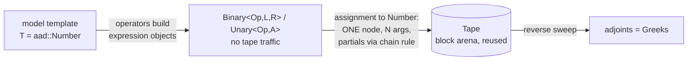

# greekstream

**Real-time options risk engine in C++20. Every Greek of a whole book comes from one reverse sweep of an expression-template AAD tape, and the gap over bump-and-revalue grows with the size of the book.**

[](https://github.com/udaykishore-resu/greekstream/actions/workflows/ci.yml)


> **Repo description:** C++20 options risk engine with hand-built expression-template AAD: Black-Scholes, American CRR trees, deterministic multithreaded basket Monte Carlo. All Greeks in one reverse sweep, benchmarked against bump-and-revalue.
>
> **Topics:** `cpp20` `automatic-differentiation` `aad` `expression-templates` `options-pricing` `greeks` `monte-carlo` `black-scholes` `binomial-tree` `risk-management` `quantitative-finance` `template-metaprogramming`

Part 3 of a three-repo low-latency trading study:
[limitbook](../limitbook) (book + matching) → [feedline](../feedline) (feed handler) → **greekstream** (real-time options risk).

---

## Why AAD

Bump-and-revalue needs `2N + 2` full revaluations for N spot deltas, N vegas and rho. Reverse-mode AD gets **all of them** from one forward recording plus one backward sweep, at a cost that is a small constant multiple of a single valuation, *independent of N*. On a desk with thousands of risk factors that is the difference between overnight batch and real time.

The catch: AAD has overhead per recorded operation, so for one or two inputs bumping can win. This repo measures where the crossover is instead of asserting that AAD always wins.

## How it works

```cpp
template <typename T>          // T = double  -> prices
T black_scholes(OptionType type, const T& spot, double strike,   // T = aad::Number -> prices AND records
                const T& rate, const T& vol, double expiry);

aad::Tape tape;  aad::ActiveTape on{tape};
aad::Number s{100.0}, r{0.05}, v{0.2};
aad::Number px = black_scholes<aad::Number>(OptionType::Call, s, 100.0, r, v, 1.0);
px.propagate_to_start();
// s.adjoint() == delta, v.adjoint() == vega, r.adjoint() == rho  (to 1e-12 vs closed form)
```



| Technique | Where | Effect |
|---|---|---|
| **Expression templates** | `aad/number.hpp` | `d1 = (log(S/K) + 0.5*v*v*t) / (v*sqrt(t))` is one tape node, not ~10 (test-enforced) |
| **Block-arena tape** | `aad/tape.hpp` | Memory kept across `clear()`/`rewind()`: no allocation after the first tick |
| **Checkpointing (mark/rewind)** | basket MC, risk engine | Monte Carlo records one path at a time; the risk engine records one *position* at a time. Tape: 184 MB → 1.6 MB |
| **Fused tree nodes** | `models/binomial.hpp` | Continuation and early exercise in one expression: tape halved, AAD 2x faster |
| **Deterministic parallel MC** | `models/basket_mc.hpp` | Fixed blocks, per-block streams, block-order reduction: **bit-identical** results on 1 or N threads (test uses exact equality) |

Design notes: [docs/DESIGN.md](docs/DESIGN.md) · C++ feature policy: [docs/FEATURE_POLICY.md](docs/FEATURE_POLICY.md)

## Quick start (macOS / Linux)

```bash
brew install cmake ninja      # or apt install cmake ninja-build g++-13
make run                      # live risk loop: AAD every tick, bump-and-revalue cross-check
make test                     # 21 tests: AAD vs closed form, vs finite differences, determinism
make bench                    # the AAD vs bump scaling chart
```

## Results (first milestone)

Measured on a 2-vCPU cloud VM (Xeon @ 2.8 GHz, GCC 13, `-O3`, single-threaded). Rerun on your machine.

**Basket Monte Carlo (8,192 paths), all 2N+1 Greeks:**

| Underlyings N | Greeks | Bump & revalue | AAD | AAD speedup |
|---:|---:|---:|---:|---:|
| 1 | 3 | 0.85 ms | 1.25 ms | **0.7x (bump wins)** |
| 4 | 9 | 4.3 ms | 1.7 ms | 2.6x |
| 16 | 33 | 48.6 ms | 3.7 ms | 13x |
| 64 | 129 | 751 ms | 12.1 ms | **62x** |

**Vanilla book (10 options per underlying, closed-form Black-Scholes):**

| Underlyings | Bump | AAD | Speedup |
|---:|---:|---:|---:|
| 1 | 1.89 µs | 1.18 µs | 1.6x |
| 16 | 238 µs | 19.8 µs | 12x |
| 256 | 57.3 ms | 0.32 ms | **179x** |

**Live demo (European calls/puts + American puts on 100-step trees):**

| Underlyings | AAD per tick | Bump per tick | Speedup | Peak tape |
|---:|---:|---:|---:|---:|
| 50 | 5.9 ms | 49 ms | 8.3x | 10.6k nodes |
| 200 | 28 ms | 726 ms | 25.6x | 10.9k nodes |

**Performance journal:** the first working version of the demo was only **2.7x** faster than bumping. Two changes got it to 25x, and both are tape-design lessons:
1. Fusing each tree node into one expression halved the tape.
2. Checkpointing per position (record, sweep, rewind) shrank the live tape from 184 MB to 1.6 MB, so the sweep runs in cache.

## Testing strategy

| Test | What it proves |
|---|---|
| `BlackScholes.AadGreeksEqualClosedForm` | Delta, vega and rho from the tape equal closed-form Greeks to 1e-12/1e-10 across calls, puts and moneyness |
| `Aad.ElementaryDerivativesMatchFiniteDifferences` | Every operator and function (exp, log, sqrt, pow, ncdf, nested) against central differences |
| `Aad.ExpressionTemplatesRecordOneNodePerAssignment` | A 12-operation `d1` costs exactly one tape node |
| `Binomial.AmericanAadDeltaMatchesCentralDifference` | AAD through early-exercise `max` matches bumping |
| `BasketMc.AadMatchesBumpOnFiveAssetBasket` | Pathwise AAD equals CRN bump-and-revalue on a correlated basket |
| `BasketMc.BitIdenticalAcrossThreadCounts` | Exact (`memcmp`) equality between 1 and 4 threads |
| `RiskEngine.TapeIsReusedAcrossTicks` | Tape memory is flat across ticks |

## Project layout

```
include/greekstream/
  aad/      tape.hpp  number.hpp
  models/   black_scholes.hpp  binomial.hpp  basket_mc.hpp
  risk/     risk_engine.hpp
  market.hpp  random.hpp
tools/      greekstream_demo.cpp
tests/      test_aad  test_models  test_monte_carlo  test_risk_engine
bench/      bench_greeks.cpp
```

## Roadmap: the parts left for you

Details in [docs/ROADMAP.md](docs/ROADMAP.md).

- [ ] **M2:** Hand-written adjoint of the CRR backward induction (no tape). Beat the tape version by 5x+
- [ ] **M3:** SIMD Monte Carlo: vectorize paths across lanes (NEON on Apple Silicon, AVX2 on x86) for the price-only path
- [ ] **M4:** Parallel risk engine: per-thread tapes over position shards, deterministic reduction
- [ ] **M5:** Second order: gamma via forward-over-reverse (dual numbers over the adjoint) or bump-of-AAD
- [ ] **M6:** Full correlation via Cholesky; Sobol quasi-random sequences (the inverse-CDF normal already supports it)
- [ ] **M7:** Event-driven: subscribe to [feedline](../feedline) ticks, recompute only positions whose underlying moved

## Skills demonstrated

- **Template metaprogramming:** expression templates with compile-time argument counting and offset assignment (`push<Offset>`), constrained operator overloads (`Expression` concept), `if constexpr`, a type-safe arithmetic DSL
- **Numerical methods:** reverse-mode AD, chain rule on a tape, checkpointing, Black-Scholes closed-form Greeks, CRR binomial trees with early exercise, Monte Carlo with antithetic variates, one-factor correlation, inverse-CDF normals (Acklam)
- **Performance engineering:** tape design (fewer, fatter nodes), memory reuse, cache residency via checkpointing, measured crossover analysis, google/benchmark scaling studies
- **Concurrency:** thread-local tapes, deterministic parallel reduction, bit-reproducible Monte Carlo
- **Modern C++ (C++20):** concepts, `std::numbers`, `thread_local` statics, defaulted special members with intent, `[[nodiscard]]`, `__extension__` 128-bit math for unbiased RNG bounds
- **Quant finance:** delta, vega, rho; basket options; American exercise; common random numbers in bump-and-revalue

## License

MIT © Udaykishore Resu
